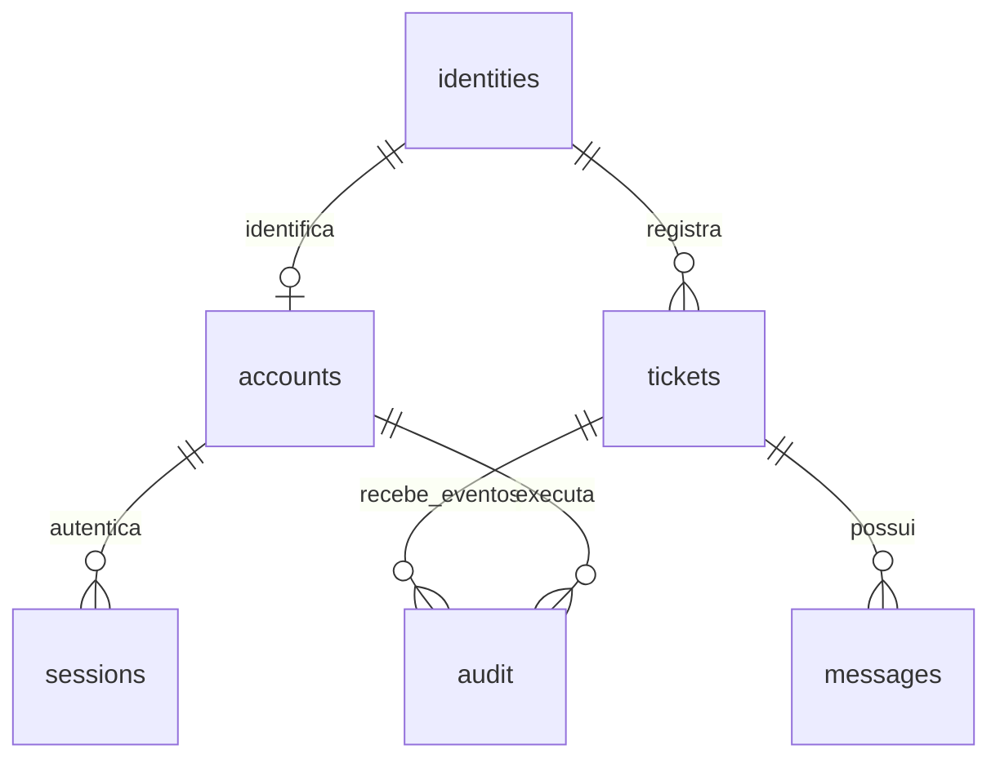

# Banco de dados da ouvidoria

O sistema usa SQLite, no arquivo `data/ouvidoria.sqlite3`. O esquema legível está em `banco.sql`; o programa contém a mesma definição e aplica migrações para preservar bancos anteriores.

## Consultar estrutura e integridade

```sh
python ouvidoria.py --banco
```

Esse comando mostra o caminho, o resultado de `PRAGMA integrity_check` e contagens. Ele não imprime e-mails, códigos de recuperação ou textos dos relatos.

## Tabelas

| Tabela | Conteúdo |
| --- | --- |
| `identities` | Identificador opaco e e-mail cifrado. |
| `accounts` | Conta, perfil e verificadores de senha e recuperação. |
| `sessions` | Sessões temporárias após login. |
| `tickets` | Manifestação original, área, andamento e arquivo. |
| `messages` | Respostas, complementos e eventos do atendimento. |
| `audit` | Consultas de autoria e ações de arquivamento. |
| `limits` | Contadores de tentativas por IP e identificador de conta. |
| `auth_meta` | Migrações realizadas e identificação da chave da instalação. |

Os nomes antigos das colunas foram preservados para compatibilidade. **A coluna chamada `email`, nas tabelas de relacionamento, agora contém um identificador `id:…`, e não o endereço em texto simples.** Não edite esses identificadores manualmente.

## Identidades e criptografia — identities

| Campo | Significado |
| --- | --- |
| `id` | Identificador derivado por HMAC, com chave e separação de finalidade. |
| `email_cipher` | E-mail protegido por Fernet, com criptografia autenticada. |

A chave é criada automaticamente em `segredos/email.key`, fora do SQLite. `DATA_KEY_FILE` pode definir outro caminho privado. A chave não é uma senha de aluno e não é enviada pelo site. Ela é necessária para descriptografar endereços e verificar os identificadores da instalação.

O banco guarda apenas uma impressão digital da chave, em `auth_meta`, para detectar o uso de uma chave incorreta. Se a chave sumir ou não corresponder ao banco já convertido, o programa recusa iniciar. Não gere outra chave como tentativa de correção: restaure a original.

A proteção atende ao cenário de alguém abrir somente o arquivo SQLite. Quem controlar o computador e ler também a chave poderá descriptografar os endereços. Os identificadores continuam permitindo correlacionar registros; isso não é criptografia de todo o banco nem anonimato contra o administrador da infraestrutura.

## Contas — accounts

| Campo | Significado |
| --- | --- |
| `email` | Referência opaca à identidade. Não contém mais o e-mail legível. |
| `salt` | Valor aleatório usado na derivação da senha. |
| `hash` | PBKDF2-HMAC-SHA256, com 600 mil iterações. Não é a senha original. |
| `role` | Aluno, supervisor ou diretor. Há restrição de um único diretor. |
| `created` | Data de criação em segundos no padrão Unix. |
| `recovery_hash` | Verificação HMAC de um código de recuperação de alta entropia; vazio em contas antigas que ainda não geraram o código. |

O código original é mostrado uma única vez ao cadastrar, gerar/renovar ou recuperar a conta. Ele não é guardado para posterior consulta. Uma recuperação bem-sucedida consome o código, gera outro e encerra todas as sessões anteriores da conta.

Criar conta não cria sessão. O usuário precisa informar novamente e-mail e senha. O cadastro público é sempre de aluno; perfis administrativos são definidos no menu local. O domínio institucional é validado, mas não há comprovação da titularidade da caixa de e-mail.

## Sessões — sessions

`hash` contém o hash do token aleatório enviado ao navegador; `email` referencia a identidade opaca; `expires` define a validade e `csrf` protege alterações autenticadas. As sessões duram oito horas. Logout remove uma sessão; recuperação ou redefinição de senha remove todas as sessões daquela conta.

## Manifestações — tickets

| Campo | Significado |
| --- | --- |
| `id` | Protocolo único. |
| `email` | Identificador opaco do solicitante. A relação é consultada pelo servidor. |
| `anonymous` | 1: autoria restrita à direção no atendimento. 0: manifestação identificada. |
| `kind` | Reclamação, crítica, sugestão, elogio ou solicitação. |
| `subject` | Assunto resumido. |
| `sector` | Área relacionada. |
| `body` | Relato original, não criptografado. |
| `status` | Recebida, Em análise, Respondida ou Resolvida. |
| `created` | Data de registro no padrão Unix. |
| `archived` | 1: arquivada para a equipe. 0: na fila principal. |
| `submission_id` | Identificador aleatório do envio confirmado; pode estar vazio em registros antigos. |

A migração cria um índice único para a combinação de solicitante e `submission_id`, quando este não é nulo. A API exige confirmação e serializa a consulta/gravação para repetir um pedido sem gerar outro protocolo. Se o mesmo identificador vier com conteúdo diferente, a solicitação é recusada.

Arquivar não exclui o registro. Uma nova mensagem ou pedido de análise do aluno retoma o atendimento. Situação, arquivo e histórico são gravados na mesma transação.

## Mensagens — messages

| Campo | Significado |
| --- | --- |
| `id` | Identificador da mensagem. |
| `ticket` | Protocolo relacionado. |
| `author` | Papel de quem escreveu: Aluno, Ouvidoria Campo Real ou Sistema. |
| `body` | Resposta, complemento ou evento de andamento. |
| `created` | Data no padrão Unix. |

A coluna `ticket` tem chave estrangeira para `tickets.id`. Cada conexão ativa `PRAGMA foreign_keys=ON`. Os textos continuam legíveis no SQLite, portanto devem ser tratados como informações sensíveis.

## Auditoria e justificativa — audit

| Campo | Significado |
| --- | --- |
| `id` | Identificador do evento. |
| `actor` | Identificador opaco da conta responsável. |
| `action` | Consulta de autoria, arquivamento ou desarquivamento. |
| `ticket` | Protocolo envolvido. |
| `created` | Data da ação no padrão Unix. |
| `reason` | Justificativa da consulta de autoria; vazio em eventos que não exigem motivo e em consultas de versões antigas. |

O diretor precisa informar justificativa de 20 a 2.000 caracteres antes de consultar autoria. A aplicação confirma a gravação desse evento antes de responder com o e-mail descriptografado. O aluno vê data e motivo em `identity_accesses`, no histórico do próprio protocolo. O supervisor não recebe essa justificativa nem a autoria anônima. A opção `anonymous` permanece ativa.

Não há envio automático de aviso por e-mail. A informação aparece ao consultar novamente o protocolo ou atualizar a página. A auditoria não é imutável: um administrador com acesso direto ao banco pode alterá-la. Evite registrar nomes ou e-mails no texto da justificativa.

## Relacionamentos



Essas são relações lógicas. A chave estrangeira formal existente é `messages.ticket → tickets.id`. Os demais vínculos são controlados pela aplicação e pelas chaves dos registros. Uma identidade pode existir sem conta, por exemplo para preservar um relato legado até o provisionamento do usuário pelo responsável.

## Integridade e migração

Há chaves primárias, unicidade de conta, restrição de um diretor e valores permitidos para perfil e arquivo. O programa usa consultas parametrizadas, validação dos campos, transações e confirmação da gravação antes de informar sucesso.

Na primeira conversão dos e-mails:

1. Campos novos são acrescentados sem recriar os relatos.
2. Endereços de contas, manifestações e auditoria passam a identificadores opacos.
3. Os endereços cifrados ficam em `identities`.
4. Sessões e contadores antigos são limpos para não manter endereços legíveis.
5. Códigos do antigo login SMTP são apagados, caso a tabela legada exista.
6. `secure_delete`, `VACUUM` e checkpoint do WAL concluem a limpeza das páginas antigas.

`auth_meta` registra a conclusão e permite retomar uma limpeza interrompida. Pare outras instâncias do serviço antes de atualizar. A migração não altera hashes de senha, protocolos, mensagens nem justificativas históricas. Ela não apaga backups antigos ou cópias exportadas fora do banco; esses arquivos podem continuar contendo endereços e precisam de proteção própria.

## Backup e restauração

```sh
python ouvidoria.py --backup
```

A API de backup do SQLite produz uma cópia consistente em `data/backups`, mesmo se outra instância estiver atendendo. O nome inclui data, hora e um sufixo aleatório. O comando não envia arquivos a serviços externos.

Guarde também uma cópia protegida da chave original, separadamente, com acesso restrito. **O backup do banco não inclui a chave.** Sem ela, o programa não poderá descriptografar os endereços nem reconhecer corretamente as identidades.

Não há agendamento, retenção automática, backup externo automático ou criptografia integral do arquivo. Os e-mails permanecem cifrados na cópia, mas relatos e justificativas continuam sensíveis. Copie os backups para outro local protegido e teste a recuperação.

Para restaurar, pare o serviço, preserve uma cópia do estado atual e restaure o banco e a chave correspondentes. Inicie o programa, execute `--banco` e confira os acessos. Não substitua arquivos de banco com o serviço em execução.

## Proteção da infraestrutura

Nunca envie `data`, backups, `.env` preenchido ou `segredos` ao GitHub. No Windows, configure permissões NTFS: os comandos `chmod` do programa não substituem esse controle. Evite guardar banco e chave juntos em pastas compartilhadas ou sincronizadas sem controle de acesso; `DATA_KEY_FILE` permite separar a chave.

Para uso institucional, configure HTTPS, administração restrita, retenção, descarte e políticas compatíveis com o tratamento de dados pessoais. A criptografia dos campos de e-mail não remove nomes ou endereços que alguém tenha digitado nos relatos, respostas ou justificativas.
