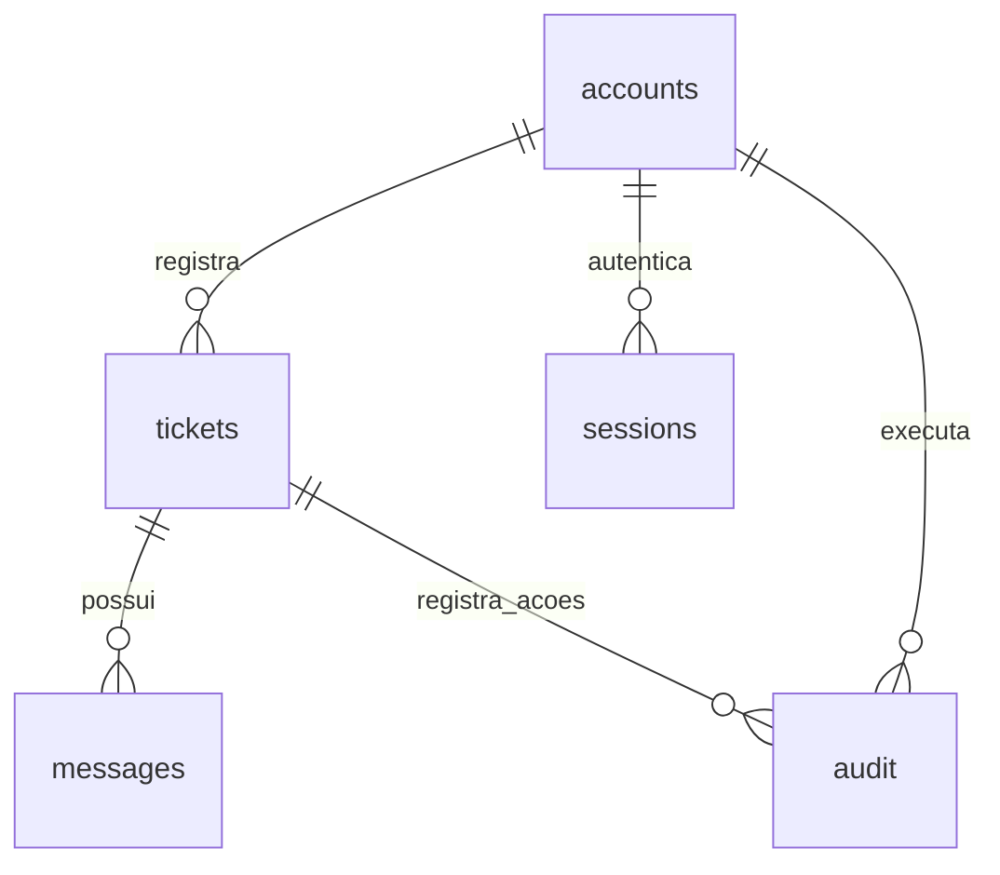

# Banco de dados da ouvidoria

O sistema usa SQLite. As tabelas ficam dentro de um único arquivo: `data/ouvidoria.sqlite3`, na pasta do programa. Não há necessidade de instalar um servidor de banco separado. O arquivo `banco.sql` apresenta a estrutura em SQL, com comentários; o programa contém uma cópia desse mesmo esquema para continuar funcionando como arquivo Python independente.

## Como consultar sem expor os relatos

Execute na pasta do projeto:

```sh
python ouvidoria.py --banco
```

O comando mostra o caminho do banco, o resultado da verificação de integridade e a quantidade de contas, manifestações, mensagens e registros de auditoria. Não imprime e-mails nem conteúdo das manifestações.

## Organização

| Tabela | Significado | Para que serve |
| --- | --- | --- |
| `accounts` | Contas | E-mail, credencial protegida e perfil de acesso. |
| `tickets` | Manifestações | Protocolo, solicitante, relato, área e andamento. |
| `messages` | Mensagens | Respostas e complementos de cada protocolo. |
| `sessions` | Sessões | Acessos temporários depois de um login válido. |
| `audit` | Auditoria | Consultas de autoria restrita e ações de arquivamento. |
| `limits` | Limites | Contadores temporários para evitar excesso de tentativas. |
| `auth_meta` | Controle de atualização | Identifica migrações já realizadas. |

Os nomes foram mantidos para preservar a compatibilidade com os bancos existentes. Os rótulos e as explicações abaixo traduzem o papel de cada campo.

## Contas — accounts

| Campo | Significado |
| --- | --- |
| `email` | Identificador único da conta, usado no login. |
| `salt` | Valor aleatório exclusivo da conta usado no cálculo da senha. |
| `hash` | Resultado de PBKDF2-HMAC-SHA256, com 600 mil iterações. Não é a senha original. |
| `role` | Perfil: `aluno`, `supervisor` ou `diretor`. |
| `created` | Data de criação em segundos desde 01/01/1970, no padrão Unix. |

O banco restringe os valores de perfil e permite apenas um diretor. O cadastro público sempre cria um aluno. Os demais perfis são cadastrados pelo menu local `--contas`. O domínio institucional é validado, mas a titularidade do e-mail não é comprovada.

## Manifestações — tickets

| Campo | Significado |
| --- | --- |
| `id` | Protocolo único, como `CR-2026-…`. |
| `email` | Conta que registrou a manifestação. É informação restrita em relatos anônimos. |
| `anonymous` | `1`: autoria restrita ao diretor no atendimento. `0`: relato identificado. |
| `kind` | Tipo: reclamação, crítica, sugestão, elogio ou solicitação. |
| `subject` | Assunto resumido. |
| `sector` | Área relacionada: infraestrutura, financeiro etc. |
| `body` | Texto original do relato. |
| `status` | Recebida, Em análise, Respondida ou Resolvida. |
| `created` | Data de registro, em formato Unix. |
| `archived` | `1`: arquivada para a equipe. `0`: na fila principal. |

Resolver e arquivar não exclui o registro. O aluno mantém acesso aos próprios protocolos e pode solicitar nova análise. A situação e o arquivamento são atualizados na mesma transação.

## Mensagens — messages

| Campo | Significado |
| --- | --- |
| `id` | Número único da mensagem. |
| `ticket` | Protocolo ao qual a mensagem pertence. |
| `author` | Identificação funcional: Aluno, Ouvidoria Campo Real ou Sistema. |
| `body` | Texto da resposta, complemento ou mudança de andamento. |
| `created` | Data de envio, em formato Unix. |

A coluna `ticket` possui chave estrangeira para `tickets.id`. A conexão ativa a verificação dessas chaves com `PRAGMA foreign_keys=ON`.

## Sessões — sessions

`hash` guarda o hash do token aleatório enviado ao navegador; `email` identifica a conta; `expires` define a validade; `csrf` protege alterações autenticadas. As sessões duram oito horas. Logout remove a sessão e redefinição de senha remove os acessos daquela conta.

**Criar uma conta não cria uma sessão.** Depois do cadastro, os campos são limpos e a pessoa precisa informar e-mail e senha no formulário de entrada.

## Auditoria — audit

`id` identifica o registro; `actor` é a conta que realizou a ação; `action` descreve o que foi feito; `ticket` indica o protocolo; `created` registra a data. A consulta de autoria pelo diretor e o arquivamento/desarquivamento pela equipe deixam esses registros.

A auditoria ajuda a rastrear ações, mas não é imutável: quem administra diretamente o arquivo do banco pode modificá-la.

## Relacionamentos



O diagrama mostra as relações lógicas do sistema. A chave estrangeira efetivamente declarada no esquema atual é `messages.ticket → tickets.id`. Os demais vínculos são controlados pela aplicação; não são todos impostos por chaves estrangeiras no SQLite. Não altere e-mails ou protocolos diretamente no banco.

## Integridade e atualizações

O banco usa chaves primárias, unicidade de e-mail, restrição de um diretor e restrição de valores para perfil e arquivamento. O Python valida os campos, usa consultas parametrizadas e confirma as transações antes de responder com sucesso. A atualização de `initialize()` cria apenas o que falta e registra migrações em `auth_meta`.

Os bancos antigos podem ainda conter uma tabela `codes`, do modelo anterior por e-mail. Os códigos são invalidados na migração e não participam do login atual.

Não exclua o arquivo SQLite para atualizar o programa. Com o serviço parado, faça backup e substitua apenas o código. Os relatos e as contas continuam no mesmo arquivo.

## Cópias de segurança

```sh
python ouvidoria.py --backup
```

O comando usa a API de backup do SQLite para produzir uma cópia consistente, mesmo quando outro processo do programa está atendendo requisições. A cópia é salva em `data/backups`, com data, hora e um sufixo aleatório. O comando não envia o arquivo a nenhum serviço externo.

Esta versão não agenda backups, não apaga cópias antigas automaticamente e não criptografa os arquivos. O responsável deve definir frequência e retenção, copiar os backups para outro local protegido e testar a restauração. Uma cópia no mesmo disco não protege contra perda desse disco.

Para restaurar, pare o serviço, preserve uma cópia do banco atual e coloque o backup escolhido no caminho do banco em uso. Depois, inicie o programa, execute `--banco` e confira os registros e os acessos. Não restaure sobre o arquivo com o serviço em funcionamento.

## Informações sensíveis

E-mails, relatos, mensagens e auditoria não estão criptografados no arquivo SQLite. A aplicação restringe a autoria anônima, mas administradores do computador ou pessoas com acesso direto ao banco podem lê-la. Os backups contêm essas mesmas informações.

As permissões de pasta e arquivo tentam restringir o acesso ao usuário do servidor nos sistemas que suportam essas permissões. No Windows, é necessário configurar também as permissões NTFS; `chmod` não substitui esse controle. Nunca envie `data`, backups ou o `.env` preenchido ao GitHub.

Para uso institucional, configure HTTPS, acesso administrativo restrito, retenção de dados, descarte e cópias protegidas. Anonimato aqui significa restrição de autoria na aplicação, não anonimato absoluto.
